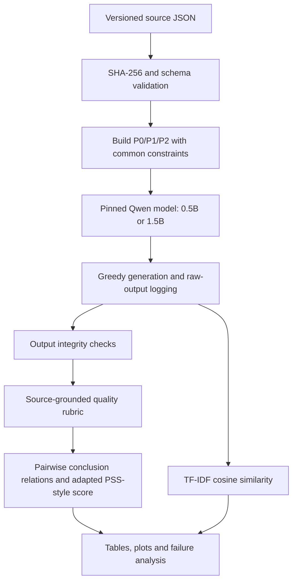

# Phase II — Experiment Plan v1.4

> **Historical status note (14 November 2026):** This is the frozen pre-collection protocol snapshot. Its original status statements and unchecked pre-collection checklist record the position before the main run. The main v1.4 experiment was subsequently executed on 10 November 2026; see D16 in `docs/research_decisions_v1_4.md` and `results/raw/main_experiment_raw_outputs_v1_4.json`. The protocol itself has not been retroactively altered.

**Project:** Prompt Sensitivity and Stability of LLM-Generated Scientific Conclusions  
**Status:** Protocol frozen for the planned main data collection; the main experiment has **not** been run.  
**Pathway:** B — Controlled comparative study.

## 1. Research question

**Primary question:** Under deterministic decoding, how do three meaning-preserving paraphrases of the same source-only instruction affect the source fidelity and substantive stability of one-sentence scientific conclusions generated by Qwen2.5-0.5B-Instruct and Qwen2.5-1.5B-Instruct when each model receives the same scientific abstract?

**Secondary question:** How well does lexical similarity between generated conclusions align with source-grounded judgments of substantive stability?

The question follows from the submitted review's distinction between output wording and conclusion variation (Section 7.2 and Table 3) and its discussion of conclusion-level robustness (Section 8.1). Prompt sensitivity and scientific claim/evidence assessment are already researched topics; this study does not claim either is unexplored.

## 2. Study design and unit of analysis

- Eight publisher-checked open-access scientific abstracts in `study_sources_v1_1_verified.json`, dataset version `v1.1`.
- Each source is passed unchanged to both model conditions and all three prompt conditions.
- Two model sizes from the Qwen2.5 instruction family are compared. This is a model-size comparison within one family, not a comparison across independent model families.
- Three task-equivalent prompts request one central-conclusion sentence. The only intended independent variable is short instruction phrasing.
- Planned main-study output count: 8 sources × 3 prompts × 2 models = **48 outputs**.
- Pilot and development outputs, including ProSA and STEM-intervention development examples, are excluded from the main dataset.
- No model training is performed; train/validation/test splitting is not applicable. The eight items form a purposive/convenience sample, not a representative sample of scientific literature.

## 3. Models and frozen settings

| Condition | Model ID | Revision SHA |
|---|---|---|
| Baseline model | `Qwen/Qwen2.5-0.5B-Instruct` | `7ae557604adf67be50417f59c2c2f167def9a775` |
| Model-size comparator | `Qwen/Qwen2.5-1.5B-Instruct` | `989aa7980e4cf806f80c7fef2b1adb7bc71aa306` |

Generation settings: greedy decoding (`do_sample=False`), `max_new_tokens=100`, seed 42 recorded, one generation per source × prompt × model. Exact revisions and environment metadata must be saved with every run. Greedy decoding reduces sampling variation but does not guarantee byte-identical outputs across all runtime/software/hardware configurations.

## 4. Prompt conditions

Use the exact same source abstract and identical common constraints for each condition. The task phrases are:

- **P0 reference:** “State the central conclusion of the scientific abstract below in exactly one sentence.”
- **P1 paraphrase:** “In one sentence, report the main conclusion of the scientific abstract below.”
- **P2 paraphrase:** “Write a single-sentence account of the principal conclusion drawn in the scientific abstract below.”

Common constraints for every condition: use only information explicitly supported by the abstract; do not add external knowledge, invent quantities, or extend the source's scope; preserve important qualifications; return exactly one sentence and no additional commentary.

The output target is deliberately one central-conclusion sentence. Earlier pilot instructions requesting both a conclusion and two findings led to incomplete or placeholder-filled multi-field responses. That task-format issue was documented before the main study. The pilot outputs are not included in main results.

## 5. Dataset and comparator validation

- Dataset file: `study_sources_v1_1_verified.json`.
- Expected SHA-256: `8c2bc1018ee04dc216c55c389ba296c1ad8138566063b1add827ed06d8393295`.
- The v1.3 run verified the hash match, eight unique source IDs, eight unique abstracts, required fields (`id`, `title`, `url`, `abstract`, `doi`, `license`) and HTTPS source URLs.
- Publisher/source links and license notes are included in the dataset and README. Cite original sources. Do not redistribute any raw content beyond its stated terms.
- Model comparators differ in parameter scale but share the Qwen2.5 family and instruction-tuning lineage; generalization to other model families is outside this design.

## 6. Evaluation metrics

1. **Primary outcome — pairwise conclusion relation:** each unordered prompt pair within source/model is classified as `stable`, `emphasis_shift`, `substantive_shift`, or `contradiction`.
2. **Source-grounded quality score:** three dimensions, each scored 0, 0.5, or 1: central-conclusion fidelity; evidential support/unsupported assertions; preservation of scope and qualifications. The overall output score is their arithmetic mean on [0,1].
3. **Adapted PSS-style score:** for each source/model, average absolute differences in output-quality scores across all three unordered prompt pairs, then summarize across sources. Lower values mean less variation in rubric scores, not truth or correctness. This is a study-specific adaptation inspired by ProSA/PSS, not an official ProSA benchmark replication.
4. **TF-IDF cosine similarity:** lowercase unigrams and bigrams on conclusion strings; report pairwise within source/model. Treat as lexical overlap only, not semantic ground truth. Clamp reported cosine values to [0,1] to avoid floating-point values marginally above 1 (observed unit-test output: 1.0000000000000007).
5. **Failure analysis:** inspect omitted qualifications, overgeneralization, unsupported quantities, high lexical similarity with a substantive shift, and low lexical similarity with stable meaning.

**Metric direction summary:** higher source-grounded quality is better; a higher stable-pair rate indicates more conclusion stability; lower adapted PSS-style scores indicate less rubric-score variation; higher TF-IDF cosine values indicate more lexical overlap only.

AI-assisted source-grounded scoring will be described as AI-assisted assessment, not independent human ground truth. The main conclusions will be descriptive; no statistical-significance claims are planned from this small purposive sample and single run per condition.

## 7. Reproducibility and data flow

`publisher-checked source JSON → schema/hash validation → common-constraint prompt builder → pinned model inference → raw JSON/CSV with metadata → source-grounded assessment → pairwise relation labels and adapted PSS-style scores → TF-IDF comparison → tables/plots/failure analysis`.

Save source IDs, exact source texts, exact prompts, model ID and revision SHA, Python/PyTorch/Transformers/Accelerate/Hugging Face Hub versions, GPU, timestamps, seed, generation settings, raw outputs, output lengths/truncation flags, and any exceptions. Never silently discard malformed outputs; record them and apply the frozen handling rule.

## 8. Deep analysis and threats to validity

Deep analysis: compare lexical similarity with substantive conclusion judgments; inspect omissions of source qualifications, unsupported strengthening of claims and invented numerical details.

Threats: only eight purposively selected abstracts; abstracts may omit context available in full papers; pretrained models may have encountered source material during training; AI-assisted scoring may have systematic errors; one model family limits generalization; a single greedy run does not estimate stochastic run-to-run variability; paraphrases may not be perfectly equivalent in every nuance.

## 9. Inputs, outputs, modules and architecture

**Input:** a record from the versioned source JSON with `id`, `title`, `url`, `abstract`, `doi`, and `license`. The exact abstract string is passed unchanged. No labels are used for training.

**Output per inference:** source ID, model ID and revision SHA, prompt ID and exact prompt string, raw one-sentence output, token count/truncation flag, seed, decoding parameters, software versions, GPU, timestamp, and any error. Malformed or empty outputs are retained and logged, never silently discarded.

**Modules:** (1) environment/logger, (2) dataset/hash/schema validation, (3) common-constraint prompt builder, (4) pinned model/tokenizer loader, (5) inference/output logger, (6) output/metric unit tests, and (7) scoring/export/plotting for main runs. Training is not performed.

**Architecture diagram (Mermaid):**

**Expected tables/figures (planned formats; no values assumed):** `results.csv` summary by model and prompt; pairwise relation counts/rates; adapted PSS-style score by model; TF-IDF similarity versus conclusion relation; figure of quality scores by prompt/model; figure of relation counts; scatter/strip plot of TF-IDF similarity versus substantive relation; and a qualitative failure-case table with source-grounded rationale.

**Compute budget:** Colab Tesla T4 observed in development. Run one model at a time; free GPU memory before loading the other. Planned main workload is 48 short generations, excluding model download/setup. If the GPU or model download fails, stop and log the actual error before changing the configuration.

## 10. Pre-collection freeze checklist

- [x] Dataset v1.1 hash/schema verified in the v1.3 Colab run.
- [x] Three prompt IDs and common constraints tested for consistent assembly.
- [x] Both model IDs and revision SHAs recorded.
- [x] Development inference produced a non-empty, one-sentence output; its source-fidelity omission is retained as a development failure case, not a result for the main study.
- [x] Adapted pairwise-score tests and TF-IDF sanity tests passed; tiny floating-point overshoot for identical-text TF-IDF is addressed by clipping reported values to [0,1].
- [x] Main sample size, conditions, metrics, exclusions and limitations stated before main collection.
- [ ] Run and archive the main 48-output experiment separately. This is outside the current Phase II/III checkpoint and remains on hold until instructed.

**Protocol freeze status:** Frozen v1.4 for the main experiment, subject to recording any instructor-required changes before data collection. No main-study outputs are included in this package.